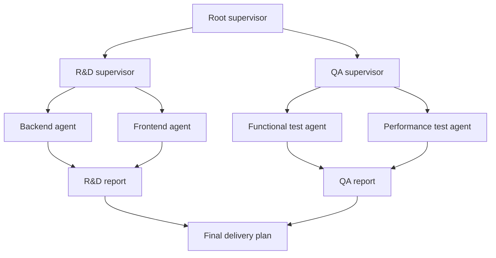

# Hierarchical Tree Multi-Agent Architecture

A three-tier supervisor demo built with LangGraph. A root agent splits a goal into domains, domain supervisors break their part into subtasks, execution agents produce deliverables, and reports flow back up level by level.


## Overview

A single supervisor works fine for five or six workers. Once the task grows into a full project with dozens of agents, one router drowns in context and starts picking the wrong agent. The hierarchical tree topology adds management layers instead of widening the star.

This project implements that topology as described in *Multi-Agent Architecture: Hierarchical Tree (Graded Master-Slave)*. The root plans, domain supervisors own their own scope, and execution agents only see the task in front of them. Each level compresses what it receives before passing it up.

The default demo goal is a small todo web app with login and CRUD, plus functional and performance testing.



## What it does

- Root agent plans the split and merges the final answer.
- R&D supervisor decomposes into backend and frontend work; QA supervisor into functional and performance testing.
- Each domain is a compiled subgraph with its own state. The root only sees the final domain report.
- Execution inside a domain runs in a loop with a hard round cap, so a supervisor cannot keep dispatching forever.
- Domain boundaries are written into the supervisor prompt, which stops the R&D line from writing test reports.
- Offline simulation is the default. Real OpenAI-compatible models are optional, and failed model calls fall back to offline text instead of breaking the run.

## Dependencies

- Python 3.10 or newer
- [LangGraph](https://github.com/langchain-ai/langgraph) for the graph runtime
- [langchain-openai](https://github.com/langchain-ai/langchain) for real model calls
- [python-dotenv](https://github.com/theskumar/python-dotenv) is optional if you prefer a `.env` file

```bash
pip install -r requirements.txt
```

## Project structure

```
.
├── main.py             # states, nodes, subgraphs, CLI
├── requirements.txt
├── readme.md
└── readme_CN.md
```

## Usage

Run the built-in check first. It executes the full offline pipeline and verifies the final plan contains both domains.

```bash
python main.py --check
```

Run the offline demo. No API key, no network, no cost.

```bash
python main.py
```

Run against a real OpenAI-compatible endpoint:

```bash
export OPENAI_API_KEY="your-key"
export OPENAI_BASE_URL="https://api.example.com/v1"
python main.py --mode llm --model gpt-4o-mini
```

On PowerShell, use `$env:OPENAI_API_KEY="your-key"` instead of `export`.

### Flags

| Flag | Description | Default |
| --- | --- | --- |
| `--goal` | Overall goal for the demo | Todo web app with login and CRUD |
| `--mode` | `offline` or `llm` | `offline` |
| `--model` | Model name for `llm` mode | `OPENAI_MODEL` or `gpt-4o-mini` |
| `--base-url` | OpenAI-compatible base URL | `OPENAI_BASE_URL` or empty |
| `--check` | Run the offline self-check and exit | off |

### Environment variables

| Variable | Purpose |
| --- | --- |
| `OPENAI_API_KEY` | Required in `llm` mode |
| `OPENAI_BASE_URL` | Optional custom endpoint |
| `OPENAI_MODEL` | Optional default model name |

## Design notes

A few decisions come straight from the failure modes of deep agent trees.

- Two management levels only. Every extra layer loses detail and adds latency. Most projects do not need a third.
- Supervisors must return a JSON task list. Free-form prose is where routing errors start.
- Subgraphs keep independent state. Passing the whole root state down invites accidental coupling.
- Every domain loop has a cap. Without it, a confused supervisor will retry the same task until the budget runs out.
- Try a single supervisor before building a tree. This structure is for scale, not for small teams.

## Contributing

Issues and pull requests are welcome. For code changes, open an issue first so the scope is agreed before you spend time on it. Keep pull requests focused on one change, and run `python main.py --check` before submitting.

## Contact

谙弆悕博士 (Ailan Anjuxi)

- Email: anjuxi.ME@outlook.com

- SIP: sip:anjuxi@sip.linphone.org

  

> © 2026 谙弆悕博士（Ailan Anjuxi），All rights reserved.
