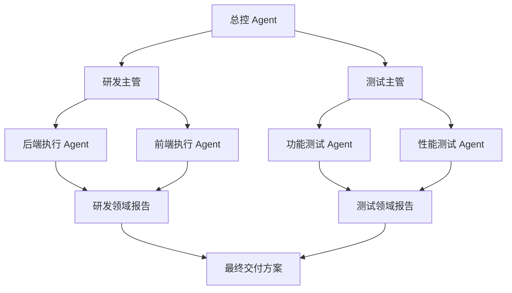

# 层级树状多智能体架构

基于 LangGraph 的三层多 Agent 演示。总控把目标拆成领域，领域主管再把任务拆给执行 Agent，结果逐层压缩后汇总回总控。


## 项目介绍

一个主管带五六个工人时，星型架构够用。任务膨胀成完整项目、Agent 数量上到几十个，单个主管的上下文会被塞满，路由也开始频繁出错。层级树状架构的做法是加管理层，而不是继续把星型摊大。

本项目的拓扑来自《多智能体架构详解：层级树状架构（分级主从型）》：总控负责规划和定稿，领域主管只管自己那一块，执行 Agent 只看到眼前的任务。每一层先把收到的内容压成报告，再往上报。

默认演示目标是开发一个支持登录和任务增删改查的待办应用，并完成功能测试与性能测试。



## 功能说明

- 总控负责规划拆解和最终汇总。
- 研发主管拆出后端、前端任务；测试主管拆出功能测试、性能测试任务。
- 每个领域是一个独立编译的子图，有自己的 state，顶层只拿到最后的领域报告。
- 领域内部用循环驱动执行 Agent，并带轮数上限，主管没法无限派活。
- 领域边界写进主管提示词，避免研发线跑去写测试报告。
- 默认离线模拟，不花 token；接真实 OpenAI 兼容接口失败时自动退回离线文案，不会中断整条链路。

## 依赖说明

- Python 3.10 及以上
- [LangGraph](https://github.com/langchain-ai/langgraph)：图运行时
- [langchain-openai](https://github.com/langchain-ai/langchain)：真实模型调用
- [python-dotenv](https://github.com/theskumar/python-dotenv)：可选，想用 `.env` 文件时再装

```bash
pip install -r requirements.txt
```

## 项目结构

```
.
├── main.py             # 状态、节点、子图、命令行入口
├── requirements.txt
├── readme.md
└── readme_CN.md
```

## 使用说明

先跑自检，它会把离线链路完整走一遍，并检查最终方案里研发、测试两个领域的内容是否齐全。

```bash
python main.py --check
```

离线演示不需要 key，也不联网：

```bash
python main.py
```

接真实接口：

```bash
export OPENAI_API_KEY="你的 key"
export OPENAI_BASE_URL="https://api.example.com/v1"
python main.py --mode llm --model gpt-4o-mini
```

PowerShell 里把 `export` 换成 `$env:OPENAI_API_KEY="你的 key"`。

### 命令行参数

| 参数 | 说明 | 默认值 |
| --- | --- | --- |
| `--goal` | 演示的整体目标 | 登录 + 任务增删改查的待办应用 |
| `--mode` | `offline` 或 `llm` | `offline` |
| `--model` | `llm` 模式的模型名 | `OPENAI_MODEL` 或 `gpt-4o-mini` |
| `--base-url` | OpenAI 兼容接口地址 | `OPENAI_BASE_URL` 或空 |
| `--check` | 只跑自检后退出 | 关闭 |

### 环境变量

| 变量 | 用途 |
| --- | --- |
| `OPENAI_API_KEY` | `llm` 模式必填 |
| `OPENAI_BASE_URL` | 可选，自定义接口地址 |
| `OPENAI_MODEL` | 可选，默认模型名 |

## 设计取舍

几个决定都是踩过深层 Agent 树的坑之后留下来的。

- 只做两层管理。每多一层就多一次信息损耗和延迟，多数项目两层够用。
- 主管必须返回 JSON 任务列表。自由文本是路由跑偏的起点。
- 子图各管各的 state。把顶层 state 整个传下去，迟早写出意外的耦合。
- 每个领域循环都要设上限。否则主管犯迷糊时会一直重派同一个任务，直到把预算烧完。
- 小团队先试单主管。层级结构是给规模用的，不是默认选项。

## 贡献指南

欢迎提 issue 和 PR。改代码前先开 issue 说明要解决的问题，避免方向不一致白做。一个 PR 只做一件事，提交前跑一遍 `python main.py --check`。

## 联系作者

谙弆悕博士（Ailan Anjuxi）

- 邮箱：anjuxi.ME@outlook.com
- SIP：sip:anjuxi@sip.linphone.org

> © 2026 谙弆悕博士（Ailan Anjuxi），All rights reserved.
